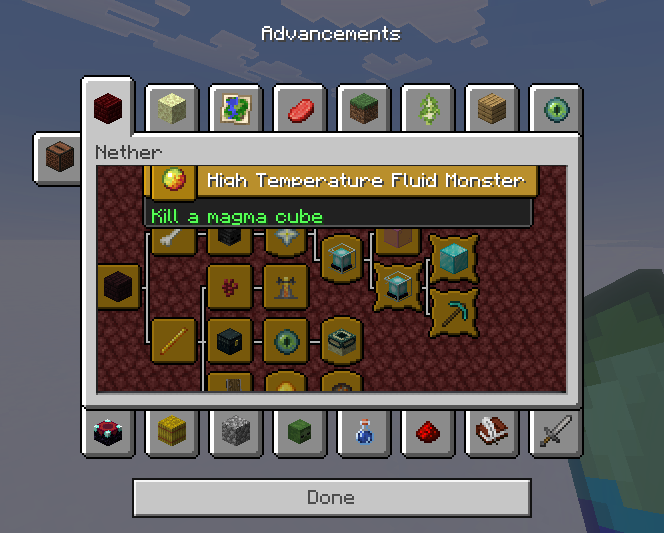
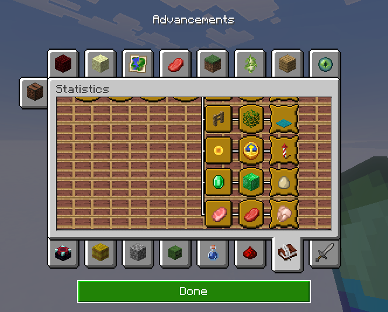
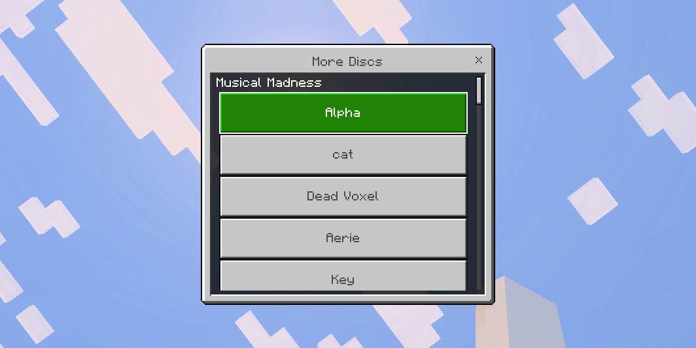

# Advancements UI: a Java-style advancements screen for Bedrock players on Geyser

Bedrock players get a copy of the Java advancements screen: the same 252×140 window, tree
layout, frames, connector lines, tabs (up to 26, in Java's positions), hover tooltips (gold/blue
title bar, green/purple description, `3/14` progress) with Java's dimming, tab backgrounds, and
**drag-to-scroll** in both directions with Java's limits. Item icons are drawn by the Bedrock
client's own item renderer, as in its inventory, so the pack ships no item pictures.
It works with any advancements, including big packs like BlazeandCave's Advancements Pack, More
Discs and the vanilla ones.




For comparison, this is Geyser's built-in `/geyser advancements` menu (still available, unchanged):


## AI Disclosure

Almost all of this project was built with AI, including this readme (barring this one section). The project was started to experiment with how AI can create server forms and replace one of the Geyser features I feel to be lacking, that being the lack of a real advancement menu. This pack probably won't be updated.

## Install (server owner)

Download both files from the [latest release](../../releases/latest) and put them on the server
running Geyser (tested on Geyser-Spigot 2.12.1 b1295 on Paper 26.3 and Geyser-Fabric 2.12.1,
Bedrock 1.26.60):

| File | Goes in |
|---|---|
| `AdvancementsUI.jar` | `plugins/Geyser-Spigot/extensions/` (Fabric: `config/Geyser-Fabric/extensions/`) |
| `advancements-ui-pack.mcpack` | `plugins/Geyser-Spigot/packs/` (Fabric: `config/Geyser-Fabric/packs/`) |

Then restart the server. Bedrock players download the pack automatically when they join
(about 35 KB).

## Use (Bedrock player)

Type **`/advancements open`** in chat. Aliases: `/advancements show`, `/advancements gui`.
Anyone can use it; no op or permission node is needed.

- **Drag** the tree with the mouse or a finger to scroll, as on Java (also when the drag starts on an
  advancement). It stops at the same edges as Java.
- **Hover** a node with the mouse, or touch it, to see its tooltip.
- **Click a tab** to switch trees. It reopens on the tab you looked at last.
- **Done** or Esc closes it.
- **Controller:** the left stick moves a pointer (Bedrock's gamepad cursor, as in the classic
  inventory). Point at a node for its tooltip, hold A and move to drag the tree, press A on a tab to
  open it. The **D-pad** steps from advancement to advancement (instantly within the view); pressing
  past the edge of the view brings the next one in that direction into view, hidden ones included.
  **LB / RB** open the previous / next tab, **B** closes the screen.

## How it works

Bedrock can't add new screens, so the extension sends an ordinary Geyser form. Its title starts
with `ADVGUI:`, and every button's text starts with a 43-character header (see `Item.java`):
eight 4-digit numbers (position, and for nodes the tooltip geometry Java's `extractHover`
computes, including its width), seven flag letters and an icon-kind digit. The resource pack overrides `server_form.json`; when it sees the
marker, it draws the Java screen instead of the usual button list. Other forms are not affected.

Button order: meta (canvas size, title, background), drag range, up to 26 tabs, connector trunks,
nodes. The pack reads the first ones from fixed indices; tabs sit in fixed slots at Java's
positions. Each node and trunk is positioned by two spacer panels whose size comes from a
number in its text (`#size_binding_x_absolute`). Each node draws its own connector stubs (a child
is always one column right of its parent, so they have fixed shapes); one trunk item per parent
draws the vertical part, pixel-identical to `AdvancementWidget#extractConnectivity`.

Dragging: the canvas is a `draggable` input panel `contained` in a box that the server places at
the opening scroll position and that reaches from there to Java's left/top limit. Opened normally
that's max(canvas, 2·canvas − view), which reproduces Java's clamp (`AdvancementTab#scroll`)
exactly. The controller's A drags too: with the gamepad cursor it arrives as `menu_ok`, which the
canvas maps to a press.

D-pad: each node has an invisible focus target under its hit area, so Bedrock's focus navigation
moves the gamepad pointer from node to node (and the hovered node shows its tooltip) without
asking the server. Focus navigation skips clipped nodes and JSON UI can't scroll the view to the
focus, so the server marks a node as an *edge* for a direction (flag 7) when no other node in the
view lies that way but hidden ones do. That node's target maps that D-pad direction to a form
response; the server then sends the screen centred on the next node that way, with the pointer
(which Bedrock resets to the screen centre) on it. The canvas is a focus container with
navigation set to `stop`, so the D-pad doesn't wrap round or leave the tree.

- `extension/`: the Geyser extension (Java). `TreeLayout.java` is a port of Minecraft's own
  `TreeNodePosition`, because Geyser doesn't keep the x/y Java computes. `AdvancementScreen.java`
  replicates `AdvancementWidget` (pixel geometry, connector lines, tooltip wrapping and placement)
  and encodes the form. `IconResolver.java` picks icons: user overrides, then Java renders if the
  pack was built with `--java-icons`, then the Bedrock item itself (Geyser's own translation, so
  custom items such as the More Discs discs work), then textures from `custom_mappings` and the
  packs in `packs/`, then Bedrock textures. A Bedrock item travels as the button's image path
  `Q` + runtime id + 50000 + damage (5 digits each); the pack's `icon_image` sees the `Q` and draws
  it with `inventory_item_renderer` and `#item_id_aux` = id × 65536 + damage. Unknown icons are logged once; override them in
  `extensions/advancementsui/icons.json`. `Text.java` reaches Adventure only through reflection,
  because Geyser-Spigot relocates it and Geyser-Fabric doesn't.
- `tools/build_pack.py`: generates the JSON UI and converts Java's GUI sprites (window, frames, title
  boxes, tabs, the vanilla tab backgrounds). Datapack tab backgrounds (`minecraft:block/...`) use
  Bedrock's own block textures, so the pack ships none. With `--java-icons` it also runs:
- `tools/render_icons.py` (optional, adds about 2.5 MB): renders every Java item's GUI icon from the client assets: item model
  definitions, model parents, tints, layered sprites, block models with Java's GUI display
  transform and its item lighting (`Lighting.ITEMS_3D` + `light.glsl`), and box models for the
  block-entity items (heads, chests, shulker boxes, shields, banners, conduit, copper golem statues).
  It also writes `extension/src/main/resources/java_icons.json`, so the extension knows what the pack has.
- `tools/gen_vanilla_icons.py`: regenerates `vanilla_icons.json`, the Java → Bedrock texture table
  for item icons and tab backgrounds. Block textures are matched through
  `tools/bedrock_block_textures.json` (Bedrock's `blocks.json` + `terrain_texture.json`, condensed),
  so `oak_planks` becomes `planks_oak` and `iron_door_top` becomes `door_iron_upper`. Re-extract
  that table from an installed Bedrock client with
  `gen_vanilla_icons.py --bedrock <Bedrock data/resource_packs> <Java client dir>`.

## Rebuilding

```sh
# pack (needs Python 3 with Pillow and numpy; bump the version every time, Bedrock caches packs by version,
# and keep it equal to `version` in extension/src/main/resources/extension.yml)
# the first argument is the unzipped Java client jar (.minecraft/versions/26.3/26.3.jar)
# add --java-icons to ship Java's GUI renders instead of using Bedrock's item renderer
# bedrock-pack/ and dist/ are build output (not kept in the repo); dist/ holds the release files
python3 tools/build_pack.py ../MC-Assets/minecraft-26.3-client bedrock-pack 1.0.0
mkdir -p dist && rm -f dist/advancements-ui-pack.mcpack && (cd bedrock-pack && zip -qr ../dist/advancements-ui-pack.mcpack .)

# extension (after the pack, which regenerates java_icons.json; needs Java 21+;
# LIBS_DIR = folder with gson, guava, failureaccess, fastutil, netty-buffer, netty-common jars)
LIBS_DIR=/path/to/libs extension/build.sh /path/to/Geyser-Spigot.jar /path/to/javac
cp extension/build/AdvancementsUI.jar dist/
```

For a release, attach both files in `dist/` to a GitHub release tagged with the version (`v1.0.0`).

Either Geyser jar works for compiling (Paper's `libraries/` folder has the extra jars). Don't
import `net.kyori` anywhere (see `Text.java`).

## Known differences from Java

- A tab opens scrolled to the bottom-right end of its tree (Java opens it centred). Bedrock clamps
  a contained drag to offsets 0…(parent − box) from where the box was laid out, whatever its anchor
  or offset, so the start has to be one end of the range. For most vanilla tabs that's a few pixels.
- Tooltips are clipped at the edge of the window's inner area (Java draws them over the frame).
  The extension flips them left/up to stay inside, judged at the opening scroll position.
- Switching tabs takes about 0.3 to 0.9 s on big trees (the form is closed and a new one is sent).
  The same goes for a D-pad press past the edge of the view; steps within the view are instant.
- After such a D-pad page the view is centred on the selected advancement (also past Java's edges)
  and can be dragged only towards the tree's left/top limit, because a Bedrock drag can only move
  away from where the canvas was laid out. Edges are judged at the scroll the form opened with, so
  after dragging, a D-pad press can page from an advancement that's no longer at the edge.
- The scrollable area reaches 16 px past the outermost advancements (Java stops right at them).
- Turning on the gamepad cursor is a screen-wide setting, so other Geyser forms also get a pointer
  on controllers.
- Description boxes are one pixel taller per line than Java's (Bedrock's line spacing, see below).
- Java's half-earned progress bar (title bar split by percentage) isn't reproduced.
- The window and its contents use Bedrock's GUI scale, so the window can look smaller or bigger
  than on a Java client with a different scale.
- Item icons are Bedrock's (its inventory renders), so a few look different from Java's. Build the
  pack with `--java-icons` for Java's look.
- Datapack tab backgrounds (`minecraft:block/...`) use Bedrock's texture for that block, which looks
  a little different for some blocks. About 280 of Java's 1300 block textures (bed parts, crop
  stages, emissive layers) have no Bedrock match and may show blank; map them in `icons.json`.

## License

The code and tools are under the [MIT License](LICENSE). The resource pack's GUI sprites are converted
from Minecraft: Java Edition's assets, which belong to Mojang. This project is not affiliated with
or endorsed by Mojang or Microsoft.
